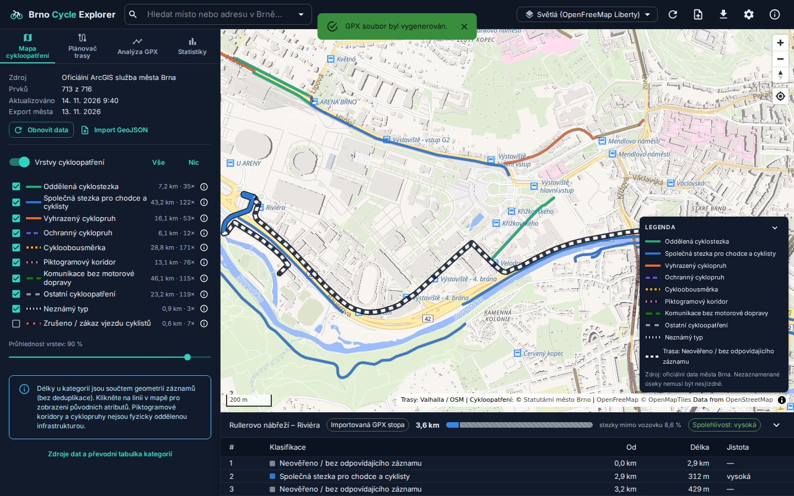

# Brno Cycle Explorer

Web app for finding, viewing, analysing and planning bike routes in Brno. It uses the city's
**official cycling infrastructure data** (ArcGIS FeatureServer) and **OpenStreetMap**. The UI is in **Czech and English**.



## Features

- **Real vector map**: MapLibre GL JS with OpenFreeMap (`styles/liberty`, `positron`, `dark`). It
  does not need an API key and never uses `tile.openstreetmap.org`. If a basemap provider is
  blocked, times out or sends an invalid style, the app shows an error with a **Zkusit znovu**
  (retry) button. It also warns when tiles fail to load. The basemap list can be changed via
  `BASEMAP_STYLES` (MapTiler, self-hosted tiles and so on).
- **Official Brno data**: the backend downloads all records. It reads the layer metadata, then
  every ObjectId, then the features as GeoJSON in WGS84 (`outSR=4326`). Downloads go in ID
  batches no bigger than `maxRecordCount`. A batch that is truncated or partial is split and
  fetched again. The data is cached to disk, refreshed every 24 h and can be refreshed by hand.
  You can also import GeoJSON by hand as a fallback. The app never makes up substitute data.
- **Classification**: a written normalization table maps every `typ_opatreni` value seen in the
  live service ([docs/NORMALIZATION.md](docs/NORMALIZATION.md)). Pictograms and lanes are **never**
  counted as separated paths.
- **Map layers**: each category can be turned on or off. You can set opacity. Hovering highlights a
  line and clicking shows its **original attributes**. The layer list has line samples (colour +
  dash pattern). The palette was checked for colour-blind safety.
- **GPX analysis**: drag-and-drop or a file picker. Handles tracks and routes with several
  segments and skips corrupted points. Distance is geodesic (haversine). Climb and descent use
  hysteresis, and a reliability flag is shown. Every route section is coloured by its category and
  can be inspected to see why it got that class.
- **Route matching algorithm** (`packages/geo/src/matching.ts`):
  1. Cut the route into pieces of at most 5 m.
  2. Look up nearby infrastructure in a Flatbush spatial index (local metric projection).
  3. For each candidate *feature*, compute the side distance of the piece's start, middle and
     end. Also compute the feature's direction where the piece projects onto it, and the
     **overlap ratio** (length projected onto the feature ÷ piece length).
  4. Reject candidates that are too far away (default 8 m), point a different way (>30°) or
     overlap too little. A crossing street therefore does not count.
  5. Assign each piece to **at most one** feature, the best geometric fit. Overlapping municipal
     lines are never counted twice.
  6. Throw out stretches shorter than 15 m as noise. Bridge gaps of 10 m or less between two runs
     of the same class (breaks at junctions); bridged parts are labelled with medium confidence.
  7. Compute length-weighted statistics, plus a **reconciliation check** (sum of categories =
     total length within 0.5 m) and a quality report.

  Parts with no matching record are labelled **"Neověřeno / bez odpovídajícího záznamu"**
  ("Not verified / no matching record"), never "road".
- **Route planner**: click to add start, destination and stops. Points can be dragged, reordered
  and deleted. Supports round trips, ride type (Pohodová / Městská / E-bike / Sportovní) and route
  preference (Maximum cyklostezek / Minimum silnic / Minimum převýšení / Nejkratší). Two routing
  engines, both over the real OSM network, selectable in the planner ("Směrovač"):
  - **BRouter** (default): custom variants of BRouter's trekking profile, changing only its
    documented parameters (`avoid_unsafe`, `consider_traffic`, `consider_noise`, `consider_river`,
    `uphillcost`, rider power for the time estimate), uploaded to the server, plus built-in
    profiles (`safety`, `trekking`, `fastbike`, `shortest`) and alternatives. BRouter also returns
    the **OSM tags of every way** on the route: sections with no municipal record are described
    as e.g. "Neověřeno · OSM: klidná ulice, asfalt", and the planner shows the unverified length
    by OSM way class. These are labelled as OSM data, never as official records.
  - **Valhalla** (bicycle costing, several `use_roads`/`use_hills` variants and alternatives).

  **Loops of a chosen length:** with "Okruh" (round trip) on and only a start point, a slider sets
  the length (5–100 km). The server places helper points on a ring around the start for four
  directions, routes them with the engine's pleasant variant, and resizes the ring once if a loop
  misses the target by more than 10 % (`packages/geo/src/loops.ts`, `apps/api/src/adapters/routing/loops.ts`).
  The app scores every candidate by matched infrastructure, distance and climb, and lets you
  compare them. Manual drawing is clearly labelled "nenavigovaná trasa" (not a navigable route).
  You can import a GPX as a starting point, export GPX, and save routes in the browser.
- **Example route**: Maloměřice → Náplavka → Riviéra → Anthropos → Maloměřice. The waypoints
  were geocoded with Nominatim (`packages/shared/src/example-route.ts`); the connected route is
  calculated at runtime.
- **Statistics**: length by category, both as recorded feature lengths **and** as the
  de-duplicated network length. Shows feature counts, length built per year (interactive stacked
  chart plus a table view), the export date, and coverage and limitations.
- **Search**: Nominatim through the backend proxy. Debounced to 600 ms, needs at least 3
  characters, sends at most 1 request per second, and results are cached.
- **Data provenance**: official records, OSM data, calculated routes, user GPX and inferred
  classifications are labelled separately (see the "Zdroje dat" dialog).

## Languages and coverage

- **Czech and English UI.** The language follows the browser (Czech/Slovak → Czech, anything else → English) and can be switched with the CZ/EN button in the top bar (desktop) or in Settings; the choice is remembered. Texts live in `apps/web/src/i18n/cs.ts` and `en.ts` (the English file is type-checked against the Czech keys).
- Logic and the server stay language-neutral: route-matching explanations, quality notes, GPX and data warnings, score explanations and API errors are **codes**, turned into text by the UI (`apps/web/src/i18n/format.ts`). API errors carry `code` + upstream `detail` next to the Czech `error` message.
- **Worldwide use:** the map, routing (BRouter, Valhalla), GPX import/analysis/export, OSM road descriptions and search work anywhere. Search is worldwide and prefers places in the visible map area. The official infrastructure layers, the path/lane classification, the statistics and the example route cover **Brno only**; elsewhere route sections show as "not verified" (with OSM descriptions for calculated routes).

## Quick start (development)

Requires **Node.js 20+** (tested with 22.21) and npm 10.

```bash
cp .env.example .env        # optional – defaults work without it
npm install
npm run dev                 # API on :3001 + Vite on :5173
```

Open **http://localhost:5173**. On first start the API downloads the official dataset (about 2 s)
into `apps/api/data-cache/`.

Windows 11: works in PowerShell and in WSL2. Paths are never hardcoded; the cache folder is
configurable (`CACHE_DIR`). macOS and Linux work the same way.

Claude Code cloud sessions need a proxy flag and an allowlisted environment. See
[docs/CLOUD_SESSIONS.md](docs/CLOUD_SESSIONS.md).

## Production (Docker Compose)

```bash
docker compose up -d --build
```

- App: **http://localhost:8080** (change the port with `WEB_PUBLIC_PORT`).
- nginx serves the built SPA and proxies `/api` to the API container, so there are no CORS
  problems.
- API health: `http://localhost:8080/api/health` (also the container `HEALTHCHECK`).
- The dataset cache is kept in the `bce-cache` volume.

Without Docker: `npm run build && npm start` runs the API on :3001. Serve `apps/web/dist` with any
static server that proxies `/api` to it (see `apps/web/nginx.conf`).

Works with Docker Desktop + WSL2 on Windows, Docker Desktop on macOS and Docker Engine on Linux.

## Live deployment (cyklo.nettio.eu)

Production runs at **https://cyklo.nettio.eu** on the nettio.eu VPS:

- Every push to `main` runs `.github/workflows/deploy.yml`: the test suite (`tests.yml`), then builds and
  pushes the public images `ghcr.io/marekmelichar/brno-cycle-explorer/{api,web}:<sha>`, then deploys.
- The deploy uses a restricted SSH key (secret `CYKLO_DEPLOY_KEY`). The server only accepts
  `deploy <sha>` for the current head of `main`, fetches `docker-compose.prod.yml` from GitHub itself and
  runs it as compose project `cyklo` with `IMAGE_TAG=<sha>`.
- `cyklo-web` joins the shared `edge` network. The platform's edge-nginx (separate repo) terminates TLS
  for `cyklo.nettio.eu` and proxies to it. The app sends its own Content-Security-Policy (see
  `apps/web/nginx.conf`).
- Pull requests run the unit tests and the Playwright browser tests (`tests.yml`).

## Configuration

All settings are environment variables. See [.env.example](.env.example). Main ones:

| Variable | Default | Purpose |
|---|---|---|
| `ARCGIS_LAYER_URL` | Brno FeatureServer layer 0 | Official data source |
| `CACHE_DIR` | `./data-cache` | Dataset cache |
| `DATA_REFRESH_INTERVAL_HOURS` | 24 | Automatic refresh |
| `ROUTING_ENGINES` | `brouter,valhalla` | Enabled engines, first = default (`ROUTING_PROVIDER=none` turns routing off) |
| `BROUTER_URL` | `https://brouter.de` | BRouter server |
| `VALHALLA_URL` | `https://valhalla1.openstreetmap.de` | Valhalla server |
| `GEOCODER_URL` / `GEOCODER_USER_AGENT` | Nominatim | Search |
| `BASEMAP_STYLES` | OpenFreeMap ×3 | JSON list of MapLibre styles |

No API keys are needed for the basemap, the official data, routing or search.

### External routing dependency

BRouter uses the **public brouter.de server** by default (no SLA, limited capacity; the app sends
at most one request per ~1.1 s and caches uploaded profiles for 30 min). For production traffic,
run BRouter yourself (Java; the Brno area needs the segment file `E15_N45.rd5`) and set
`BROUTER_URL`. Valhalla stays available as the second engine.


By default, automatic routing uses the **public FOSSGIS Valhalla instance**
(`valhalla1.openstreetmap.de`). It has a fair-use policy and **no SLA**. If it is unreachable,
the planner shows the error and no route is drawn: the app never falls back to straight lines.
For heavier use, run your own Valhalla with a Czech OSM extract
(e.g. the `ghcr.io/gis-ops/docker-valhalla/valhalla` image with
`tile_urls=https://download.geofabrik.de/europe/czech-republic-latest.osm.pbf`) and set
`VALHALLA_URL`. Set `ROUTING_PROVIDER=none` to turn routing off. Map, GPX analysis, manual
drawing and statistics keep working either way. Other engines (e.g. GraphHopper) can be added by
implementing `RoutingProvider` in `apps/api/src/adapters/routing/`.

### Basemap providers

OpenFreeMap's public instance has no SLA. To use another provider, set `BASEMAP_STYLES`, for
example:
`[{"id":"maptiler","label":"MapTiler","url":"https://api.maptiler.com/maps/streets-v2/style.json?key=KEY","dark":false}]`.

## Architecture

```
apps/
  api/        Fastify REST API (Node + TS)
    src/adapters/brno-gis/    ArcGIS client (metadata, ID batching, split on truncation, retries, timeouts)
    src/adapters/routing/     RoutingProvider interface, Valhalla, None
    src/adapters/geocoding/   Nominatim (rate-limited queue + cache)
    src/services/             InfrastructureService (refresh, cache, import, last error)
    src/cache/                atomic JSON file cache
    src/routes/               /api/health, /api/config, /api/infrastructure[/meta|/refresh|/import], /api/route, /api/geocode
  web/        React + TS + Vite + MUI + MapLibre + TanStack Query + Zustand + Recharts
    src/features/map|infrastructure|gpx|routing|analytics
packages/
  shared/     types, category definitions + normalization table, example route
  geo/        geospatial core with no React: distance, GPX parse/export, normalization, matching, statistics, scoring
tests/
  e2e/        Playwright (desktop + mobile)
  fixtures/   real ArcGIS sample + layer metadata, real Brno GPX route
```

GPX files are processed **in the browser only**; they are never uploaded. Settings and saved
routes are kept in `localStorage`.

## Tests

```bash
npm test             # Vitest: 56 unit + integration tests
npm run test:e2e     # Playwright: starts dev servers if they are not running
E2E_BASE_URL=http://localhost:8080 npm run test:e2e   # against the Docker build
```

- Unit tests: geodesic distance (checked against Turf.js), polyline decoding, GPX parsing (several
  segments, corrupted points, missing elevation, invalid files, round trip), elevation hysteresis,
  normalization (real ArcGIS fixture, Web Mercator, null geometries), segment matching (parallel,
  tolerance, perpendicular crossing, short contacts, overlaps and ambiguity, mixed routes,
  pictograms, excluded records, invalid vertices, outside coverage, gap bridging), dataset
  de-duplication, and route scoring.
- Integration tests: an ArcGIS emulator with **4 500 records over a 2 000-record limit**,
  `exceededTransferLimit` splitting, partial and incomplete responses, HTTP and JSON errors,
  timeouts, cache persistence and warm start, keeping the last good data after a failure, no
  invented data, single-flight refresh, GeoJSON import, and the REST routes (Fastify inject,
  Valhalla adapter mocked).
- Browser tests: the map container has a real size; MapLibre loads the OpenFreeMap style;
  vector features are **actually rendered** (streets, water, labels); vector tiles return HTTP
  200; no `tile.openstreetmap.org` requests and no "Access blocked" text; **pixel analysis** of a
  map screenshot (number of distinct colours, share of the dominant colour); the official overlay
  is rendered; clicking a feature shows its attributes; toggling a category hides or shows it
  without moving the map; switching basemap keeps the overlays and the view; a blocked basemap
  shows the error and retry works; GPX import → statistics → section explanation; GPX export is
  checked as XML (namespace, version, coordinates); the example route is calculated through
  Valhalla and exported; no console errors; desktop and mobile screenshots go to
  `tests/screenshots/`.

Linux without root: Playwright's Chromium needs `libnss3`, `libnspr4` and `libasound2`. Normally
run `npx playwright install --with-deps chromium`. Without sudo, you can extract the packages
with `apt-get download libnss3 libnspr4 libasound2t64` + `dpkg-deb -x` and point
`LD_LIBRARY_PATH` at them.

## Data sources and licences

- Cycling measures: © Statutární město Brno, open data (data.brno.cz).
- Basemap: OpenFreeMap, © OpenMapTiles, data © OpenStreetMap contributors (ODbL).
- Routing: Valhalla (FOSSGIS), data © OpenStreetMap contributors.
- Search: Nominatim, data © OpenStreetMap contributors.

## Known limitations

- The municipal dataset covers only Brno's recorded measures. Paths through forests and fields,
  quiet streets and the surrounding towns are often missing, so a high "Neověřeno" share does not
  mean a route is bad.
- The classification is inferred from geometry. Parallel infrastructure within 8 m of a road
  (e.g. a path beside a main road) can be ambiguous; this is flagged in the quality report.
- Route scoring does not model traffic volume or safety; the app has no such data.
- Public Valhalla, Nominatim and OpenFreeMap instances have no SLA.
- Valhalla returns alternative routes only for 2-point requests. For more points, the variants
  come from different engine parameters.
